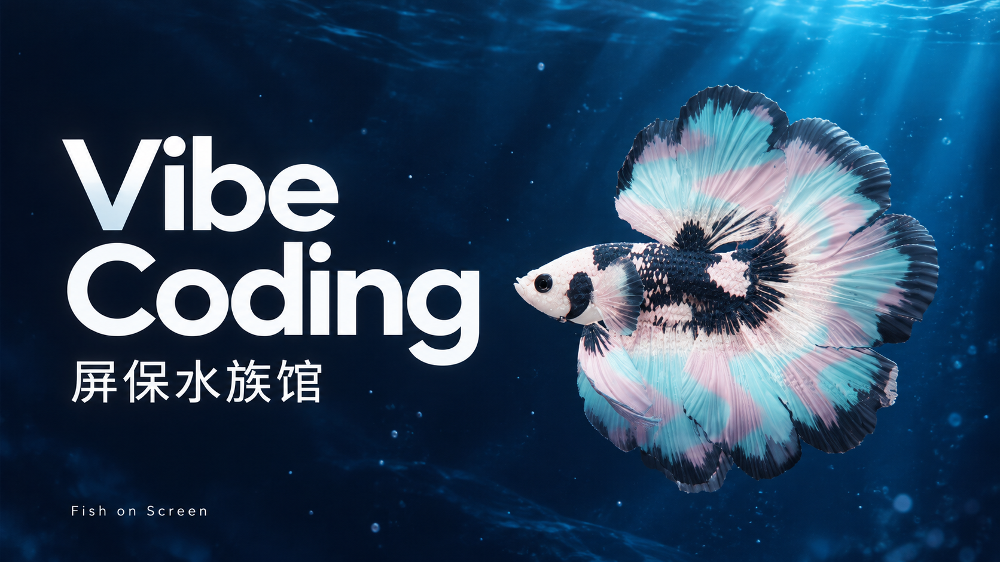
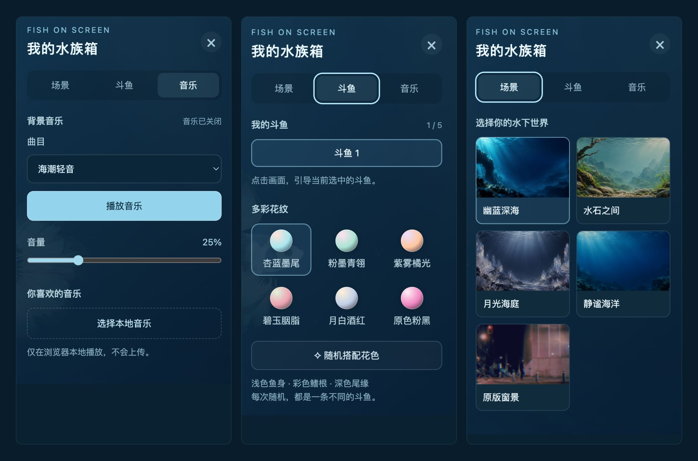

# Fish on Screen 🐠

把屏幕变成一座安静的水族馆。柔软的斗鱼在光束和水波间自由巡游，点击水面，它就游向你。

一个以 **Vibe Coding 屏保水族馆** 为主题的浏览器交互项目，使用 Three.js 与 XPBD 约束模拟斗鱼的身体和鱼鳍。纯静态部署，模型、背景、音乐和运行依赖均随仓库提供。

**在线体验 → [打开 Fish on Screen 水族馆](https://yinchao-jack.github.io/fish-on-screen/)**

## 我的水族箱



从左到右：**音乐** · **斗鱼** · **场景**。右上角的控制面板可以随时展开或收起。

## 可以怎么玩

- **自由巡游**：每条斗鱼独立游动、柔和转身，84 个骨骼节点带来柔软的尾鳍动态。
- **点击引导**：点击画面任意位置，引导当前选中的斗鱼，抵达后自动恢复巡游；水面浮现半透明涟漪。
- **自己的鱼群**：最多添加 5 条斗鱼，可选择、移除、切换配色与鳍形。
- **丰富花纹**：6 种预设配色与随机花色，浅色鱼身、彩色鳍根、深色尾缘；半月、柔纱、花瓣三种鳍形。
- **五种水下世界**：幽蓝深海、水石之间、月光海庭、静谧海洋、原版窗景。动态光束、轻微色散、焦散与景深漂移让背景缓慢呼吸。
- **轻音乐**：两段程序合成的循环音乐，支持播放、暂停、切换和音量调节，也可以选择自己的本地音频。本地音乐只在浏览器播放，不会上传。
- **可爱的加载体验**：小斗鱼标志搭配弹性旋转进度环，随真实资源加载进度变化。

## 本地运行

下载仓库 ZIP，或克隆项目：

```sh
git clone https://github.com/yinchao-jack/fish-on-screen.git
cd fish-on-screen
python3 -m http.server 8080 --directory dist
```

然后打开 **http://localhost:8080**。需要支持 WebGL 的现代浏览器，不需要安装 npm 依赖或构建。请通过 HTTP 服务访问，不要直接双击 HTML 文件。

点击水面引导斗鱼，滚轮调整视野，右上角打开控制面板。音乐默认关闭，设置与本地音乐仅作用于当前页面，刷新后恢复默认。

## 部署

将 `dist/` 的内容部署到任意支持静态文件的服务器即可。所有资源使用相对路径，可部署在子目录下。

本仓库已启用 GitHub Pages，从 `main` 分支的仓库根目录发布；根目录的 `index.html` 会引导至 `dist/`。推送更新后，GitHub 会自动重新部署。

## 项目结构

```text
dist/
  index.html       页面、样式与加载界面
  main.js          Three.js 场景、XPBD 约束、水波与巡游
  settings.js      场景、斗鱼与音乐控制面板
  music.js         音乐播放与本地音频
  backgrounds/    生成的水下背景
  vendor/         Three.js、模型解码器与字体
  …               模型、视频、音乐与图标
docs/images/      宣传封面与 UI 展示图
```

## 致谢与素材

项目的造型与初始窗景参考 [Fish&me](https://fish-and-me.ok.kimi.link/)，在此基础上加入巡游、多鱼管理、场景、配色、音乐和水波等功能。新增背景与宣传封面使用图像生成模型制作。

Three.js、模型解码器与字体遵循各自的开源许可，许可证收录于 [docs/licenses](docs/licenses/)。斗鱼模型、原版窗景等第三方素材的权利归原权利人；本仓库不对这些素材授予额外许可。
